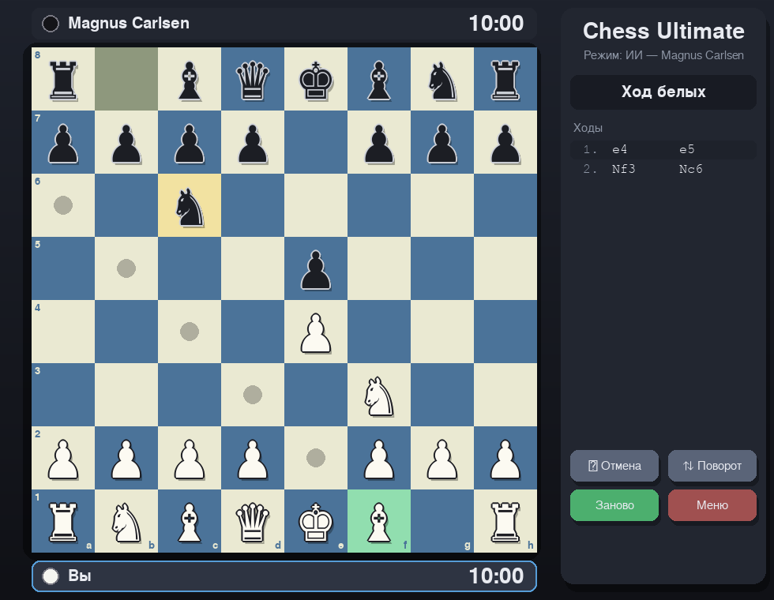

# ♟ Chess Ultimate

Шахматы на **Python + Pygame** с анимациями, шестью уровнями ИИ и режимом для двух игроков.



## Возможности

- **Играть против ИИ** или **вдвоём за одним ПК** (PvP)
- **6 уровней сложности:** Лёгкий, Нормальный, Сложный, Невозможный, Magnus Carlsen, Narek Hakobyan
- Выбор цвета против ИИ (белыми или чёрными)
- Плавная анимация ходов и красивое вращение доски на 180° в режиме PvP
- Подсветка последнего хода, шаха и возможных ходов, выбор фигуры при превращении пешки
- Шахматные часы (10 минут каждому), список ходов в нотации SAN
- Отмена хода и ручной поворот доски
- ИИ считает в отдельном потоке, поэтому окно не зависает

## Установка и запуск

Нужен Python 3.9 или новее.

```bash
git clone https://github.com/27Narek27/chess-ultimate.git
cd chess-ultimate
pip install -r requirements.txt
python chess_ultimate.py
```

## Управление

| Действие | Как |
|---|---|
| Сделать ход | ЛКМ: выбрать фигуру, затем клетку |
| Отменить ход | кнопка «Отмена» или `U` |
| Перевернуть доску | кнопка «Поворот» или `F` |
| Выйти в меню | кнопка «Меню» или `Esc` |

## Уровни ИИ

| Уровень | Как играет |
|---|---|
| Лёгкий | Глубина 1, шум в оценке и случайные ошибки |
| Нормальный | Глубина 2, небольшой шум |
| Сложный | Глубина до 4, до 3 сек на ход |
| Невозможный | Итеративное углубление, до 6 сек на ход |
| Magnus Carlsen | Позиционный стиль (проходные пешки, открытые линии), дебютная книга, до 9 сек |
| Narek Hakobyan | Агрессивный стиль (давление на короля), дебютная книга, до 7 сек |

> Имена Magnus Carlsen и Narek Hakobyan обозначают **стиль игры**, а не точную имитацию этих шахматистов.
> Движок написан на чистом Python, поэтому по силе это сильный любитель, а не гроссмейстер.
> Время на ход и глубину можно менять в словаре `LEVELS` в начале файла.

## Как устроен движок

- Негамакс с альфа-бета отсечениями
- Итеративное углубление с лимитом времени
- Таблица транспозиций (Zobrist-хэш из `python-chess`)
- Квиесценс-поиск (разрешение взятий)
- Сортировка ходов: ход из таблицы, MVV-LVA, killer-ходы, history-эвристика
- Сокращение перебора для поздних тихих ходов (LMR) и расширение при шахе
- Оценка: материал, таблицы клеток для фигур, пара слонов, проходные пешки, король в миттельшпиле и эндшпиле

## Структура проекта

```
chess-ultimate/
├── chess_ultimate.py   # вся игра: движок, интерфейс, меню
├── requirements.txt
├── docs/screenshot.png
├── LICENSE
└── README.md
```

## Планы

- [ ] Оценочная шкала и подсказка лучшего хода
- [ ] Сохранение и загрузка партий (PGN)
- [ ] Выбор контроля времени
- [ ] Звуки ходов

## Лицензия

[MIT](LICENSE)